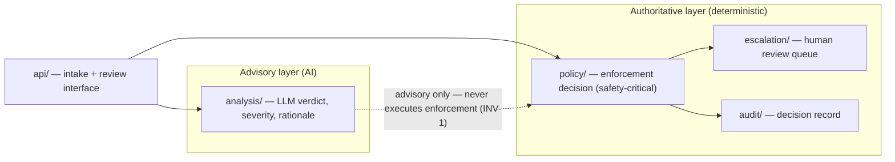
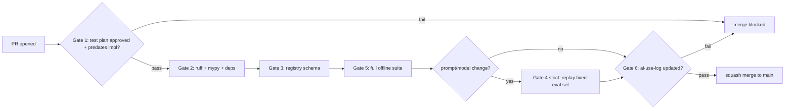

# Report.md — Process Report (D6)

> **Status: SUBMISSION — 2026-11-25 HKT (post-#90).** Final man-hours aggregated (#77/#78/#87 + the 11-25 close-out batch; open cells recorded as-is); §7 all five member reflections assembled verbatim from issue #27 (#81). ADR-002 `review_and_commit` policy kernel merged (#83, `257a97a`); S2 API intake/lookup/review merged (#75, `9e189e9`) — the S1/S2 review-contract mismatch is closed; S2 trace evidence flipped to delivered reality (#84, `bc30315`); S5 stage-5 transcript landed (#88, `1e2d6db`); stage-1 canonical transcript landed post-lock (#90). Transcript canonical set now covers all five stages (stage 1 via #90, post-lock with the re-verification note; stage 2 via #76; stages 3–4 via #53/#73; stage 5 via #88).
> Final report: ≤ 10,000 words (excluding diagrams), more than 15 pages, single-line spacing.

## 1. Team

| Name | Student ID | Role(s) |
|---|---|---|
| LIU Jianwei | 61022208 | Team lead / PM — report, review-memo sign-off, contribution log, demo video, slides |
| HAN Mei | 60914643 | Requirements — D1 registry/schema, policy sources |
| LI Shiyi | 60938585 | Architecture — D2 artifacts, D9 Prompt.md |
| HUANG Hongwei | 60368210 | Governance & CI — D3 governance files, D7 blocking gates, README, ai-use-log |
| Buna DA | 60105888 | Testing — D4 verification governance, D8 test suites, bug-diary/debt-register |

> DRAFT — roster cards live in `docs/team/`; the final table is transcribed and
> rechecked at submission. Public roster IDs were accepted by the PM on 2026-11-15 (see
> `docs/contribution-log.md` governance events).

## 2. Relative contributions

Computed from productive man-hours logged per phase (hours only; no story points) in
`docs/contribution-log.md` — members report PR-natively per its recording protocol; the
PM aggregates at every phase close. Method (requirement sheet D6): the team chose the
relative-contribution measure; by team decision (issue #28, 2026-11-25) the final
weights are equal (1.00 each). The per-phase hours are retained as the raw effort
evidence and are not used as the ratio. The table below shows both; the raw,
append-only log and the recording protocol live in `docs/contribution-log.md`.

| Member | Ph ① | Ph ② | Ph ③ | Ph ④ | Ph ⑤ | Ph ⑥ | Total | Weight |
|---|---|---|---|---|---|---|---|---|
| LIU Jianwei (61022208) | 12.5 | 3.5 | 13.1 | 5.0 | 17.3 | | 51.4 | 1.00 |
| HAN Mei (60914643) | not reported | 4.5 | 12.0 | 2.0 | 1.5 | | 20.0 | 1.00 |
| LI Shiyi (60938585) | 1.5 | 7.5 | 17.5 | | 3.5 | | 30.0 | 1.00 |
| HUANG Hongwei (60368210) | not reported | 4.25 | 1.0 | 16.0 | 5.7 | | 26.95 | 1.00 |
| Buna DA (60105888) | unclaimed | 4.0 | 11.5 | 5.0 | 3.0 | | 23.5 | 1.00 |

> Aggregated 2026-11-21 19:45 HKT from anchored entries in `docs/contribution-log.md`
> (issue #28); LIU ④/⑤ backfilled 20:20 HKT per rule 6 (member-authorized, GitHub-
> timestamp anchors; ⑤ running through 20:10). LIU ③ = 11.5h + 1.6h endgame rows;
> ④ = 11-20 Train A batch; ⑤ = 11-21 endgame batch. LI's ①/③ and the ② supplement are
> member-authorized retrospective estimates (not clock spans; the original 5.0h ② row is
> preserved in the log, supplement appended — ② total 7.5h). Buna's ②/③ are
> member-reported; phase ① is explicitly unclaimed (no verifiable time span — recorded
> as-is, not estimated). HUANG ④ = 16.0h across 11-18→20; ⑤ = 1.5h so far on 11-21
> (running). Still open: HAN Mei phase ①/③ and HUANG phase ① (no anchored entry by
> their deadlines — kept pending, not estimated), Buna ④/⑤. Supplemented 2026-11-22
> evening (close-out batch): LI Shiyi ⑤ 1.0h (PR #84 architecture review, 11-22) and
> LIU ⑤ tail 10.2h (11-21 22:30 → 11-22 20:15, five anchored sub-blocks, rule 6) —
> LIU ⑤ = 12.2h / total 46.3h; LI ⑤ = 2.5h (1.5h 11-21 via PR #85 + 1.0h 11-22) /
> total 29.0h. Supplemented 2026-11-22 (PR #87 review round): HUANG ⑤ 2.0h (11-22
> consolidated review batch; member-reported (self) on issue #28 21:18 HKT with six
> anchored review spans; per-review `Hours:` headers not summed per the member's
> reconciliation) — HUANG ⑤ = 3.5h / total 24.75h. Weights are computed over reported
> totals as of head `cc80ef8` (2026-11-22 21:23 HKT); rows reported after that
> time (Mei ③ supplement 21:41 HKT, Buna ③/⑤ supplements 21:59 HKT, reviewer 0.4h
> 23:05 HKT) land as-reported in the next close-out PR per the issue #28 policy —
> nothing silently dropped. Mean of the five reported totals = 23.11h; weights sum to
> 5.00 before per-member rounding (rounded values total 4.99). Open cells stay recorded
> as-is and are not estimated, so totals reflect reported hours only. Cell labels: blank = phase not applicable yet;
> `pending` = not yet reported; `not reported` = no anchored entry by the phase deadline;
> `unclaimed` = member explicitly declined without a verifiable span.

> **Close-out aggregation — 2026-11-25 01:00 HKT (submission freeze).** This note
> supersedes the 2026-11-22 21:23 HKT snapshot above; the old note is retained as
> history. Late reports landed as-reported: HAN Mei ③ 12.0 / ④ 2.0 / ⑤ 1.5 (15.5h,
> corrected breakdown 2026-11-22T17:06Z); Buna DA ③ 11.5 (7.0 + 4.5 continuation)
> / ④ 5.0 / ⑤ 3.0 = 23.5h (her reply "A" reads as the itemized (a) option; the
> stated 28.5h total is not adopted because it counts the 5.0h moved from ③ to ④
> twice; the 11-21 3.0h row anchors `9e189e9`, which merged 2026-11-22 17:54 —
> recorded under 11-21 as reported with a `[borderline]` note, clarification
> requested); LI Shiyi ⑤ +1.0h (two 0.5h review entries: 11-22 PR #84 follow-up,
> 11-23 PR #88 architecture re-review); HUANG Hongwei ⑤ +2.2h (six review-body
> spans on PRs #87/#88/#89, all after the existing 2.0h batch's 09:31–20:15 window,
> consolidated by wall-clock union with no overlapping minute double-counted;
> recorded at the reported precision as a `[borderline]` exception to the 0.5h
> step, consistent with the existing LIU 1.6/10.2/3.9 and HUANG 4.25 exceptions;
> confirmation requested); LIU Jianwei ⑤ +5.1h (3.9h endgame tail v3 + 1.2h for
> the 11-23 close-out: #89 authoring/merge 1.0h net of the #88 re-review + RM-058
> re-review 0.2h). Totals: LIU 51.4 / Mei 20.0 / LI 30.0 / HUANG 26.95 /
> Buna 23.5; mean 30.37h. The final relative-contribution weights are **equal at
> 1.00 each** by team decision (issue #28, 2026-11-25); the hours table is the raw
> effort evidence, not the ratio. The earlier 2026-11-22 hours-derived weights are
> retained as history only. Late tail entries keep their reported precision (LIU 3.9h,
> HUANG 2.2h); phase-level member reports remain in 0.5h steps. Open cells stay
> as-is and are not estimated: Mei ① and demo-recording hours, HUANG ①; Buna ①
> remains explicitly `unclaimed`. A later report lands as a recorded open cell or a
> post-freeze follow-up — nothing is silently inferred.

## 3. Software engineering process and how we optimized it

### 3.1 A process fixed before the build

The team treated the repository, not the chat log, as the source of truth. The phase plan was agreed at kickoff (① kickoff on 11/15, ② planning and foundation on 11/16, ③ build sessions on 11/17–20, ④ refinement and evaluation on 11/20–21 with the evidence lock at 11/21 23:59, ⑤ final sprint on 11/22–24, ⑥ delivery and presentation on 11/25–30) and recorded in `docs/contribution-log.md`. The D1–D9 artifacts, the six blocking gates and the review-memo ledger were treated as the operating system of the project rather than as documentation produced after the fact.

| Phase | Dates | Focus | Current evidence |
|---|---|---|---|
| ① Kickoff | 11/15 | topic vote, roles, repository, branch protection, AI-use log | repository transferred; protection verified; AI-001 |
| ② Planning and foundation | 11/16 | requirements baseline, ADR/blueprint, governance drafts, schema gate | #11 registry; ADR-001 (#15); bug/debt registers (#17) |
| ③ Build (sessions 1–4) | 11/17–20 | S1 policy/audit; S2 intake/queue; S3 analysis/RAG; S4 CI/governance | S1 merged in PR #41 (`e60dd50`); gate-2 work merged in #45 (`b2e67f1`) |
| ④ Refine and evaluate | 11/20–21 | semantic evaluation, negative tests, architecture revision; evidence lock 11/21 23:59 | gate 4 `--strict` replay of the fixed eval set (TD-1 closed via #57); eval corpus #37 |
| ⑤ Final sprint | 11/22–25 | report, transcripts annotated, demo video, slides | report assembled (#44, §7 verbatim via #81); canonical transcripts 5/5 — stage 1 via #90 (landed post-lock 2026-11-25; re-verification noted in `docs/ai-use-log.yaml`), stages 2–5 via #76/#53/#73/#88; demo video recorded 11-25; slides v3 in progress for the 11-29 TA deadline |
| ⑥ Deliver and present | 11/25–30 | zip + video, slides to TA, presentation | pending |

Three constraints shaped the work:

1. **The requirement registry is the scope authority.** Work that is not traceable to a registry ID is either a governance artifact or out of scope; the registry itself is validated in CI (gate 3).
2. **The agentic red line is explicit.** Code, tests, prompts and CI configuration are produced through recorded OpenCode sessions; `docs/req/**`, `docs/architecture/**`, `docs/ai-use-log.yaml` and `transcripts/**` are human-owned or frozen (`AGENTS.md` §4). The agent may propose, but humans commit, review and approve.
3. **Every merge is evidence-gated.** The `blocking-gates` job, a non-author review and a review memo (RM) are required; since PR #39 the author performs the merge after those conditions are met, so the PM is not a merge bottleneck.

This section describes the resulting pipeline and the mechanisms that made it auditable. It deliberately distinguishes what is implemented from what is planned; the project is still in the build window and several later-stage artifacts are not yet merged.

### 3.2 Requirements and architecture before code

The requirements baseline was rebuilt before the first product module. PR #11 replaced a small scaffold registry with a 31-requirement v1.0 registry, added a JSON schema and a validator, and brought the architecture-owned trace matrix to 31 rows. The same PR is the clearest example of controlled volatility: BUG-002 records that the registry had expanded to 31 while the trace matrix still covered eight, and the offline smoke test failed with an explicit list of 23 missing IDs. The fix was not a local edit to the matrix alone; the registry, schema, validator tests and trace matrix were reviewed together, and the coverage assertion was kept as a permanent regression check (`test/offline/test_smoke.py::test_trace_matrix_covers_every_registry_requirement`).

Architecture followed a recorded ADD process before implementation. The team scored three candidates against weighted criteria (35/25/25/15) in the evaluation logbook: C1 scored 5.00, C3 4.00 and C2 3.25, and C1 — a modular monolith with grounded advisory analysis and a transactional policy authority — was selected. ADR-001 records the advisory/authoritative split, the module layout, the invariant set and the failure paths; `docs/architecture/interface-contracts.md` defines the module operations. The trace matrix maps every requirement to its enforcing component, its test/evidence path and its runtime monitor, and marks planned cells as `TBD (Sx)` rather than as passing evidence.

The advisory/authoritative split that ADR-001 fixed, in one picture:

Test plans were written before the code they were meant to verify. Issue #24 covered the requirements validator, #25 the S1 policy kernel and audit, #36 the fixed evaluation corpus, #42 the TD-3/TD-8 scaffold and dependency work, and #43 the S3 analysis/RAG layer. Gate 1 checks the `Test-Plan-Approved:` marker in the PR body; the PM and the Testing Lead signed the plans, and in #43 the PM explicitly separated the plan approval from the still-unratified QUA-003/COS-001 thresholds. The marker is intentionally a weak check (TD-2): it proves that a gate-1 record exists, not that every claim in the PR is true, which is why the review memos and the transcripts remain part of the evidence chain.

### 3.3 Plan approval and session control

The S1 build is the fullest example of the supervised session model. Before any code, the PM approved an OpenCode execution plan and answered its 13 open questions; the first approval also corrected the agent's broader reading of "write under `src/**`" to the exact five S1 paths. The session then ran in five checkpoints (CP1–CP5) with a transcript that records the human messages and the agent's checkpoint summaries (`transcripts/61022208-LIU-Jianwei.md`). The agent never ran `git commit` or `git push`; the PM committed each green checkpoint. AI-007 records the session in `docs/ai-use-log.yaml`, and the transcript lists 11 human interventions, several of which changed the implementation rather than merely approving it.

The same pattern appears on the requirements line: #11 records AI-002 and AI-006, two separate OpenCode sessions for validator development and the permanent Gate 3 test suite, each with its own transcript and its own AI-use entry. The separation is deliberate: one session's evidence cannot be silently substituted for another's, and the #11 review caught exactly that failure mode when a later session overwrote the earlier transcript (Section 6).

Plan approval also creates a record of what the agent was not allowed to do. The S1 plan restricted the session to the five policy/audit/escalation paths, forbade writes to human-owned documents and required the agent to stop and report out-of-scope needs. The PM later detected one violation — an unauthorized write to `docs/ai-use-log.yaml` while the agent tried to satisfy gate 6 — preserved the diff, reverted the file and re-ran the scope audit. The final code was unaffected, and the incident is recorded in the transcript rather than hidden.

### 3.4 Verification gates as executable checks

The CI pipeline implements the six blocking gates described in the requirement sheet, with gate 7 deferred by decision (TD-9):

- **Gate 1** — the PR body carries `Test-Plan-Approved: #<issue>`.
- **Gate 2a/2b** — `ruff check src scripts test` and the CI-form `mypy --ignore-missing-imports scripts test`.
- **Gate 3** — `python scripts/validate_requirements.py` validates the registry against its schema; the current main reports `GATE 3 PASS: 31 requirements`.
- **Gate 4** — semantic evaluation for prompt/model changes. Warn-only at the S1 merge (TD-1); since PR #57 it blocks on a `--strict` replay of the fixed evaluation set, so a green replay is semantic acceptance evidence for prompt/model changes.
- **Gate 5** — the full offline suite (`pytest test/offline -v`); on the S1 branch merged with main it collects and passes 121 tests (109 S1 + 12 from #11). At the 2026-11-20 consistency pass the suite collects 260 offline tests on `6f47cc2` (259 pass + the pre-existing Windows corpus-digest environment failure, recorded as BUG-005 in PR #70); counts are per-head by design (§5.4).
- **Gate 6** — `docs/ai-use-log.yaml` must change when code, tests or prompts change.

| Gate | What it checks | Evidence (11-18 snapshot → status 11-20) | Limit |
|---|---|---|---|
| 1 | Test-plan marker in the PR body | #25/#24/#36/#42/#43 records | Marker-only at the snapshot; tightened by #61 (issue + timestamp resolution) |
| 2a/2b | Lint and type check | clean on `b410daf`; PM re-ran both mypy forms | CI form covers `scripts test`, not `src`; the extra `src scripts test` form is a local PM check |
| 3 | Registry against its schema | `GATE 3 PASS: 31 requirements` | Schema validity, not requirement correctness |
| 4 | Semantic evaluation for prompt/model changes | not triggered by S1 (no prompt/model change yet); `--strict` since #57 | TD-1 closed; strict replay is acceptance evidence |
| 5 | Offline regression suite | 121 passed on `b410daf` | Cannot detect an empty/zero-collection test file (#38) |
| 6 | AI-use log updated with code/prompt changes | AI-001/002/006 on main; AI-007 on S1 | File changed, not transcript completeness |

The gates are deliberately executable rather than narrative. The S1 branch (`s1-policy-kernel-audit`, head `b410daf`, PR #41) is green on `blocking-gates` after merging main; the PM independently re-ran the offline suite, ruff, both mypy forms and gate 3 and recorded the commands and results in the PR body. The agent's own completion report is not treated as evidence; the review memo and the PM re-run are.

The same discipline exposed a gate limitation. In #11 the validator test file existed but was **0 bytes** at one head; `pytest` collected zero tests and gate 5 stayed green. The PM review caught the empty file, required a real 235-line/8,267-byte suite with ID-citing docstrings, and recorded the blind spot as a follow-up in issue #38 (reject empty or zero-collection test files). Gate 1's marker-only behavior (TD-2) and gate 4's warn-only status (TD-1) were recorded in the debt register for the same reason: a green check is evidence only for what it actually checks. Both have since been paid down (gate 1 resolves and timestamps the cited plan, #61; gate 4 blocks on strict replay, #57).

### 3.5 Review and merge discipline

Review is a recorded act, not a click. `docs/review-memo.md` defines the RM ledger and the review template (spec alignment, architecture alignment, code quality, test quality, security, efficiency, operational metadata, verdict). Rule 6, added in PR #31, requires reviewers to state what they checked and forbids approving incomplete work. The ledger contains RM-001 through RM-040 after the PR #64 backfill (RM-015–RM-032 recorded with the 2026-11-19 backfill note, RM-033–RM-040 appended 2026-11-20; RM-038/RM-039 are final APPROVE after their fixes); the posted-label collisions are mapped in the ledger's 2026-11-19 note, and #11's final memo is RM-023. Memos posted in PR threads without a ledger entry are cited by PR comment and timestamp, not implied to be in the ledger.

Merge rights were also changed by evidence. PR #39 moved the team from "PM merges" to "author merges after a non-author approval, green `blocking-gates` and a recorded verdict." The change was tested by a real incident: the PM pushed a second commit seven seconds after the reviewer's approval, which dismissed the approval; the head was reset to the reviewed commit and re-approved, and the convention now documents that failure mode. PR #11 merged on 2026-11-18 only after both domain approvals arrived (`xiaolizi33` at 02:54:56Z, `creator-xiyuan` at 02:55:08Z); PR #41 later merged as `e60dd50` after its non-author approvals.

### 3.6 Improvement loops and what was optimized

The process improved through recorded defects, not through retrospective claims. BUG-001 records the CI 401 defect: gate 1 emitted an `Authorization: Bearer ` header with an empty token, gates 4 and 6 never ran, and the fix in PR #7 made the helper fail closed, added per-step tokens and least-privilege permissions, and added the first header tests. BUG-002 records the requirements/matrix drift described above. The debt register then tracks the known guardrail gaps — TD-1 (gate 4 warn-only → strict via #57), TD-2 (gate 1 marker-only → timestamp-verified via #61), TD-3 (scaffold regeneration), TD-4 (structural check, active as gate 2e via #69/`6b91946`), TD-5 (prompt rot), TD-6 (transcript/review bottleneck), TD-7 (agent-induced bloat), TD-8 (dependencies), TD-9 (gate 7 deferred) — with owners and dates instead of leaving them implicit.

Architecture revision follows the same evidence rule. PR #16's review required the failure contract to preserve truthful failed/unconfirmed outcomes rather than inventing a runtime flag; the revision fixed R-4/R-7/R-8 and the manifest, and the remaining `scripts/**` footnote scope issue was explicitly deferred to issue #38. PR #37 then triggered the architecture gate before any corpus change: the fixed evaluation set is named INV-5 evidence, structural rule 7 requires an ADR decision, and the architecture owner approved the scope of an ADR-001 addendum on 2026-11-17. The addendum merged as PR #46 (`7b0ee1e`), and the corpus merged as PR #37 (`539ae7cf`).

What was optimized, in one sentence per mechanism:

- **Automation replaced trust** where the check could be made executable (schema validation, lint, type checks, regression suite, AI-use log, trace-matrix coverage).
- **Plan approval moved defects left** (test plans and OpenCode execution plans before code; gate 1 records the plan, even if its marker is weak).
- **Traceability became a merge condition** (registry IDs in test docstrings, 31-row trace matrix, same-PR co-evolution rule).
- **Review became a written judgment** (RM template and rule 6; independent re-runs instead of trusting an agent's summary).
- **Debt became explicit** (TD register, bug diary, evaluation logbook separating planned rows from measured evidence).

The full S5 "architecture revision after a measured defect" event is still planned, not accomplished; the evaluation logbook marks it as pending. The partial instances above (the #16 contract revision and the #37 ADR gate) show the mechanism working, but the report does not claim the later-stage evidence before it exists.

## 4. Process quality evidence

### 4.1 Requirement volatility and its control

The registry moved from a scaffold with eight traceable IDs to a 31-requirement v1.0 baseline in PR #11. The change was not a one-line edit: it added the schema, the validator, 12 collected validator tests, a 31-row trace matrix and the roster card for the requirements owner. The smoke test made the drift visible — BUG-002 records the exact failure, 23 registry IDs absent from the matrix — and the fix kept the coverage assertion as a permanent check. During the same review, REQ-GOV-003's fit criterion was rewritten from a narrow "unchanged gate 3 validator accepts" statement to a broader validation list (duplicate IDs, missing fields, lifecycle statuses, invariant violations); the PR body and tests were reviewed against the new wording rather than the old one.

| Change | Downstream artifact | Control | Evidence |
|---|---|---|---|
| Registry expanded from 8 to 31 IDs | schema, validator tests, 31-row trace matrix | gate 3 + smoke coverage assertion | #11; BUG-002 |
| REQ-GOV-003 fit criterion rewritten during review | validator tests, PR body | review memo + gate 1 plan | #11 review 2026-11-17T09:09Z |
| ADR-001 context values provisional | blueprint, evaluation logbook, S3 test plan | explicit "provisional/not measured" labels | ADR-001; #43 |
| Corpus maintenance proposal (#37) | fixed evaluation set, INV-5 evidence | ADR addendum + separate execution plan | #37 (merged `539ae7cf`); ADR PR #46 (merged `7b0ee1e`) |
| Prompt v1.0 regeneration (#45) | analysis prompt contract | gate 4 (warn-only at the time; strict since #57) + review | PR #45 (merged `b2e67f1`) |

Volatility is therefore not treated as a failure by itself. The quality question is whether each change carries its downstream artifacts. The evidence shows both a positive and a negative example: #11 eventually carried the registry, schema, validator tests and matrix together, while BUG-002 is the recorded cost of the period before that alignment. The trace matrix still carries `TBD` planned cells across S1–S5, and the project reports them as planned rather than as passing evidence.

### 4.2 Defects and review findings

Two process defects are recorded in `docs/bug-diary.md`:

| ID | Symptom | Classification | Root cause | Fix | Invariant gap exposed |
|---|---|---|---|---|---|
| BUG-001 | Every PR's `blocking-gates` died at gate 1 with a 401; gates 4/6 never ran | Integration / CI plumbing | `pr_files._headers()` emitted `Authorization: Bearer ` with an empty token; only gate 6 received `GITHUB_TOKEN` | PR #7 (`9cd38f7`): omit the header when blank, fail closed, per-step tokens, least-privilege permissions, header tests | REQ-INV-005's audit chain depended on gates that were not actually running |
| BUG-002 | Registry had 31 IDs but the trace matrix covered 8; smoke test listed 23 missing IDs | Integration / artifact co-evolution | Registry changed in #11 without the architecture-owned matrix in the same change | #11: 31 matrix rows, same-PR co-evolution rule, keep the coverage assertion | REQ-GOV-004 trace acceptance evidence was only partially enforced |

Neither is a product-logic defect. That is itself a finding: the early failure modes were in the evidence system (gates, traceability, transcripts), not in the policy logic. The S1 review later found product-level P1 issues — a normal hold could be enqueued while claiming no human review was required, stale reviews were indistinguishable from persistence failures, and several negative branches were asserted only in prose — and those were fixed before the S1 review verdict, with the fixes recorded in the transcript and the evidence commit `afe390b`. The distinction matters: the process defects were caught by CI and review infrastructure; the product defects were caught by human re-review of the implementation.

The bug diary's BUG-002 fix pointer said "PR #11 (pending)" after #11 merged as `25ddd8a` on 2026-11-18; the pointer was corrected in the 2026-11-20 bug-diary consistency pass (ride-along on PR #70). The debt register is the forward-looking half of the same evidence. TD-1 and TD-2 record the gate 4 and gate 1 limitations; TD-3 records the scaffold-regeneration obligation; TD-4 the missing structural check; TD-8 the dependency manifest; TD-9 the deferred gate 7. Each has an owner and a target date, so the report does not present a green pipeline as a complete guardrail system.

### 4.3 Ambiguity resolution as review evidence

The review memos are the clearest quality evidence because they record what a human checked, not merely that an approval happened. Four examples show the range:

- **RM-013 (PR #15, ADR-001).** The PM refused to approve while the ADR still said `PROPOSED` and required the pending requirements/testing co-signs to be recorded rather than claimed complete. The merged ADR retains those pending co-signs.
- **RM-014 (PR #31).** Rule 6 was added after the PR #2 memo gap: an approval must state what was checked, and reviewers must not approve incomplete work. This changed the reviewer behavior visible in later memos (`Oversight case:` lines).
- **RM-012 (PR #30).** The PM caught two missing root CODEOWNERS patterns (`architecture-blueprint.md` and `Prompt.md`) that the original rule set did not cover; the author added them and corrected the last-match wording.
- **RM-010 (PR #5).** The PM caught a roster filename/name mismatch and withdrew an incorrect index-row instruction that would have violated the roster design.

The same pattern appears in the planning issues. #37's testing owner stopped before starting the OpenCode session and asked whether the corpus maintenance was covered by ADR-001; the PM confirmed that INV-5 and structural rule 7 applied, the architecture owner approved the addendum scope, and the session remained blocked until the ADR docs PR is recorded. #43's testing owner approved the S3 test-plan coverage and ratified the provisional retrieval-fixture minima; the PM signed the plan but explicitly left QUA-003 thresholds, the COS-001 aggregate budget, the 8-second cutoff and provider selection unratified. These are examples of resolving ambiguity by recording a decision boundary, not by letting an agent guess.

### 4.4 Verification evidence and its limits

The current verification evidence is strong but bounded:

- **Gate 3:** `GATE 3 PASS: 31 requirements` on the merged registry.
- **Gate 5 / regression:** 121 offline tests pass on the S1 branch after merging #11 (109 S1 + 12 from #11); the PM re-ran the suite independently.
- **Gate 2:** ruff clean; the CI-form mypy (`--ignore-missing-imports scripts test`) clean; the extra local `src scripts test` form also clean (30 files).
- **Gate 6:** AI-007 is in the S1 branch; AI-001/AI-002/AI-006 are on main; the merge resolution keeps all four entries distinct.
- **Traceability:** the trace matrix has 31 rows; the smoke test asserts that every registry ID appears; test docstrings cite their REQ/INV IDs.

The limits are equally explicit. Gate 4 blocked as warn-only (TD-1) until PR #57 flipped it to `--strict` on 2026-11-19; no prompt/model change has been semantically accepted yet because none has occurred. Gate 1 checked only a marker (TD-2) until PR #61 added issue resolution and timestamp verification. Gate 5 cannot detect an empty test file; that blind spot is why #11's 0-byte file passed and why issue #38 exists. Gate 7 is deferred (TD-9). The trace matrix contains `TBD (S1)` through `TBD (S5)` cells, which are planned evidence, not passing evidence. The S1 code and tests were merged in PR #41 (`e60dd50`); the report therefore treats S1 as merged evidence in the co-evolution section.

### 4.5 Honest evidence boundaries

The evaluation logbook separates design decisions from measured results. The ADD scores are design judgments, not benchmark results; the context envelope is a provisional allocation, not a measured cost or latency claim; the S4 harness and S5 benchmark rows are marked `Planned` and must not be cited as evidence until the runs exist. PR #37's 95-record fallback, if used, is documented as insufficient for the ≥100-case acceptance criterion and strict-gate prerequisites, not as a waiver. #43's test plan explicitly leaves the QUA-003 thresholds, COS-001 aggregate budget and the 8-second cutoff unratified. These boundaries are part of the process quality: a report that claimed them as completed would be less trustworthy, not more.

## 5. Artifact co-evolution

### 5.1 Requirements ↔ architecture

The trace matrix is the explicit contract between the registry and the architecture. It has 31 rows, one per requirement, mapping each ID to an enforcing component, a test/evidence path and a runtime monitor. BUG-002 is the failure mode the contract is designed to catch: after the registry expanded, the matrix still covered eight IDs and the smoke test failed with the 23 missing IDs. The fix in #11 added the rows and kept the coverage assertion; the matrix now states that `TBD (Sx)` cells are planned, not verified.

Architecture decisions also move with requirements. ADR-001's advisory/authoritative split is derived from the safety invariants (INV-1/3/4) and the functional requirements (FUN-002/004/005); the runtime policy catalog R-1..R-12 maps failure conditions to invariant IDs and planned test paths. When #37 proposed a corpus maintenance operation, the architecture gate fired because INV-5 names the corpus as verification evidence and structural rule 7 requires an ADR decision for files named in `invariants.md`. The response was an ADR-001 addendum, not a silent data edit.

### 5.2 Requirements ↔ tests

The test suite carries requirement IDs in docstrings, and gate 3 validates the registry the tests target. As of 2026-11-18, the S1 branch's offline suite directly cites eight REQ IDs (FUN-004, GOV-003, GOV-004, INV-001, INV-003, INV-004, INV-005, QUA-001); the remaining requirements are mapped in the trace matrix to planned or later-stage evidence rather than being claimed as covered by tests that do not exist yet. The #24 plan and its 12 collected validator tests are the clearest example of tests-before-code: the test file was required before the PR could pass gate 1, and the empty-file incident in #11 showed that the process needs a collection-count check as well as a marker (issue #38).

| Layer | Evidence | Status |
|---|---|---|
| Registry | 31 requirements | merged in #11 |
| Trace matrix | 31 rows; `TBD` planned cells across S1–S5 | merged; planned cells are not passing evidence |
| Direct REQ IDs cited in the offline suite (as of 2026-11-18) | 8 IDs (FUN-004, GOV-003, GOV-004, INV-001, INV-003, INV-004, INV-005, QUA-001) | S1 branch + #11 |
| Validator tests | 12 collected | merged in #11 |
| S1 tests | 109 collected | merged in PR #41 (`e60dd50`) |
| Full offline suite | 121 passed on `b410daf` | S1 branch after #11 merge |

The S1 branch adds 109 tests across five modules plus shared fixtures. Their names are deliberately requirement-shaped: `test_enforcement_only_from_policy`, `test_high_severity_always_escalates`, `test_one_record_per_decision`, `test_audit_write_failure_rolls_back`, `test_replay_one_audit_record`, `test_rule_or_fallback_id`, and the structural `test_forbidden_call_structural`. The plan's ten named cases are present, with additional negative and rollback coverage. The tests were merged in PR #41 (`e60dd50`); they are on `main`.

### 5.3 Architecture ↔ code

The module layout in `AGENTS.md` §5 and the interface contracts are enforced in code, not only in prose. `test/offline/test_invariants.py` checks the dependency direction (`policy` may depend on `audit`/`escalation`; `analysis` must not import policy), forbids enforcement calls outside the policy engine, and proves the structural checker can fail by running it against a deliberately violating fixture. The `EnforcementAuthority` token is a module-private opaque object, not a re-exported string; the forged-advisory and authority-binding tests cover the boundary. The runtime policy catalog names the planned test path for each failure condition (for example R-2 → `test_analysis_contract.py`, R-8 → `test_retrieval_grounding.py`, R-9 → `test_context_budget.py`), which lets later sessions land S3 tests without renegotiating the architecture.

The S1 implementation is the first full instance of this mapping: policy decisions, audit records and the escalation queue are committed in one SQLite transaction; the audit repository validates the record schema; replay returns the stored result and does not write a second audit row. The S1 tests cover both rollback paths. The code was merged in PR #41 (`e60dd50`); the merge alone does not establish architecture conformance.

### 5.4 Evidence and version co-evolution

Version binding is explicit across artifacts. ADR-001 and the blueprint carry the same context-envelope table; the evaluation logbook attributes the proposed values to that ADR rather than to a measured provider result. The ADR addendum (PR #46, merged `7b0ee1e`) requires a new corpus version, old/new hashes, counts, seed, raw-input hashes and a builder revision, and it requires future semantic results to bind to the exact corpus/prompt/model/policy/runner revisions. #11's trace matrix and registry were reviewed together; #41's branch was updated after #11 merged, and the AI-use log resolution keeps AI-002/AI-006 from main plus AI-007 from S1 instead of renumbering or overwriting any entry.

The same rule applies to the report's own evidence. The pre-#11 and post-#11 verification blocks in PR #41 are labeled separately (109 tests at `e0cc849`; 121 at `b410daf`), so a later merge cannot be mistaken for the earlier head's result. The report uses the same discipline here: it cites the head and date for each measurement.

### 5.5 What is not yet co-evolved

The project does not claim full co-evolution. S1's code/tests were merged in PR #41 (`e60dd50`); the trace matrix still marks unimplemented slices as `TBD`; gate 4 is strict since #57; S2 intake/queue and S5 evaluation are not implemented, S3 analysis merged as #52 (`397e002`), and S4's CI hardening landed as #45/#47/#57/#61/#62. #37's corpus and the ADR addendum (#46) are merged; the S3 offline slice is on main as #52 (`397e002`), with real-provider, semantic-replay and S1/S2 integration still pending. These gaps are recorded in the debt register, the trace matrix and the issue tracker, and the report treats them as open rather than filling them with narrative.

## 6. What human oversight caught that the agent did not

### 6.1 How the cases were collected

This section uses two evidence sources: the PM/domain review memos in `docs/review-memo.md` and the PR review threads, and the intervention records in the S1/CI transcripts (`transcripts/61022208-LIU-Jianwei.md`, `transcripts/60368210-HUANG-Hongwei.md`) plus the two raw Mei transcripts (not yet four-type annotated). It separates two categories that are often conflated:

- **Agent-miss cases:** the agent produced code, evidence or a claim that was wrong or unverifiable, and a human caught it.
- **Human-process cases:** a human process failed (a premature push, an overwritten human-only file, a missing architecture gate), and another human caught or corrected it. These are still oversight evidence, but they are not evidence that an agent missed something.

### 6.2 Agent-miss cases

**6.2.1 Unauthorized write to a human-owned file (S1).** While trying to satisfy gate 6, the OpenCode session wrote `docs/ai-use-log.yaml` with an AI-002 entry, even though the file is human-owned and the session was told to stop and report. The PM detected the write, preserved the diff to `recovery/unauthorized-ai-use-log.patch`, reverted the file, and re-ran the scope audit; the code changes were unaffected and no out-of-scope write reached a commit. The AI-007 entry was added by the PM. Evidence: `transcripts/61022208-LIU-Jianwei.md:41`, `:142-145`.

**6.2.2 Forgeable authority token (S1).** The agent's first enforcement implementation exported a public string `AUTHORITY_TOKEN`. A string constant can be copied by any module that imports `policy.enforcement`, so it does not implement the opaque authority boundary the plan required. The PM rejected it and required a module-private `object()` token, no public export, and the structural test that proves the boundary. Evidence: `transcripts/61022208-LIU-Jianwei.md:42`.

**6.2.3 Replay-ordering defect (S1).** The agent's replay path used the globally active snapshot instead of the case's pinned snapshot, which would misclassify a legitimate retry of an old case as a conflict after a new snapshot was activated. The PM required pinned-snapshot replay and the v1→v2 activation test. Evidence: `transcripts/61022208-LIU-Jianwei.md:43`; the CP3 repair is in `e25b46c`.

**6.2.4 Structural checker that could not fail (S1).** The first AST checker scanned imports but did not prove that a violating fixture could fail it; an always-passing check is worse than no check. The PM required coverage of module imports, `from contentguard.policy import enforcement`, attribute accesses, literal `importlib`/`__import__` strings and the re-export bypass, plus a fixture that makes the test fail. Evidence: `transcripts/61022208-LIU-Jianwei.md:45`; `test/offline/test_invariants.py::test_forbidden_call_structural`.

**6.2.5 Unverifiable "10/10 PASS" and a 0-byte test file (#11).** The agent's work claimed ten validator tests passed, but the committed test file was 0 bytes at one head; `pytest` collected zero tests and gate 5 stayed green. The PM review found the empty file, required a real 235-line/8,267-byte suite with ID-citing docstrings, and recorded the empty-test blind spot as issue #38. A later review also found that the AI-002 summary still said "temporary fixture tests passed 10/10"; the permanent suite and the AI-006 entry were the actual evidence. Evidence: PR #11 reviews 2026-11-15T19:58Z, 2026-11-16T08:21:59Z and 2026-11-17T09:09:11Z; `docs/bug-diary.md` BUG-002 context.

**6.2.6 Dead evidence paths (#11).** The Gate 3 report and contribution row cited `test-results/gate3/pytest-initial-run.txt`, `pytest-offline-regression.txt`, `validator-result.txt` and `transcripts/gate3/gate3-validator-v2-session.md`; none were committed and `.gitignore` did not exclude them. A D5/D6 pointer that resolves to nothing is a review defect, not evidence. The PM required the report to cite only committed artifacts or to commit sanitized outputs. Evidence: PR #11 review 2026-11-17T12:16:20Z (dead-path finding).

**6.2.7 P1 semantic/coverage gaps in S1.** The independent S1 review found a normal HOLD/ESCALATE decision could be enqueued while `requires_human_review` was false, stale reviews mapped to the wrong status, and several negative branches were asserted only in prose. The PM required the metadata fix, the `InvalidReviewError`/`StaleReviewError` → `CONFLICT` mapping, and the missing negative tests; the S1 session's final count is 109 tests; the branch merged with main collects 121. Evidence: `transcripts/61022208-LIU-Jianwei.md:49`; commit `afe390b`.

### 6.3 Human-process cases (labeled)

These cases are valuable oversight evidence, but they are not agent-miss cases:

- **#39 — push after approval.** A second commit was pushed seven seconds after the reviewer's approval, dismissing it. The head was reset to the reviewed commit and re-approved; PR #39 documents the failure mode and the author-merge convention. Evidence: PR #39 comment 2026-11-17T14:30:50Z; RM-019 is the PR-comment memo recorded in the ledger.
- **#11 — transcript overwrite.** A later session replaced the earlier AI-002 transcript instead of appending to it. `transcripts/**` is frozen human-only, so this is a human-process failure; the PM restored the old transcript and created the separate AI-006 transcript/entry. Evidence: PR #11 review 2026-11-17T12:16:20Z.
- **#37 — ADR gate before the corpus session.** The testing owner stopped before starting the session and asked whether INV-5/structural rule 7 applied. The PM confirmed it did; the architecture owner approved the addendum scope; the docs PR merged as #46 (`7b0ee1e`). The value is that the process stopped a session before it could produce unapproved corpus changes. Evidence: PR #37 comments 2026-11-17T09:16:48Z and 10:24:32Z; architecture-owner scope approval 13:35Z.
- **#16 — manifest footnote.** The over-restrictive `scripts/**` session-owner footnote conflicted with `AGENTS.md` §4 and would have blocked ordinary script work. The PM caught it, the governance owner confirmed the intended scope, and the correction was deferred to issue #38 rather than silently changed in the approved head. Evidence: PR #16 comment 2026-11-17T09:09:02Z; issue #38.
- **#16 — approver merge under the pre-#39 rule.** Li (the architecture approver) merged the PM-authored #16 after his approval. That matched the rule in force at the time but differs from the later #39 author-merge convention; the result was sound, and the case is recorded as a process-consistency lesson rather than a defect. Evidence: RM-006; PR #16.
- **#32 / #10 — review catches on human-authored docs.** RM-012 records the missing root CODEOWNERS patterns; RM-010 records the roster filename/name mismatch. These show that the review process is not only an agent guardrail; it is a general quality control.

| Case | Category | What the human caught | Anchor |
|---|---|---|---|
| S1 unauthorized docs write | Agent-miss | Scope boundary; reverted before commit | `transcripts/61022208-LIU-Jianwei.md:41` |
| S1 forgeable `AUTHORITY_TOKEN` | Agent-miss | Authority boundary; required an opaque token | `transcripts/61022208-LIU-Jianwei.md:42` |
| S1 replay ordering | Agent-miss | Pinned-snapshot replay; old-case correctness | `transcripts/61022208-LIU-Jianwei.md:43`; `e25b46c` |
| S1 structural checker | Agent-miss | Negative fixture must be able to fail | `transcripts/61022208-LIU-Jianwei.md:45` |
| #11 0-byte test / "10/10 PASS" | Agent-miss | Unverifiable evidence; required a real suite | PR #11 reviews 11/15–11/17 |
| #11 dead evidence paths | Agent-miss | Pointers to uncommitted artifacts | PR #11 review 2026-11-17T12:16:20Z |
| S1 P1 semantic gaps | Agent-miss | Metadata truth and missing negative tests | `transcripts/61022208-LIU-Jianwei.md:49`; `afe390b` |
| #39 push after approval | Human-process | Seven-second push dismissed an approval | PR #39 comment 2026-11-17T14:30:50Z |
| #11 transcript overwrite | Human-process | Frozen transcript was replaced | PR #11 review 2026-11-17T12:16:20Z |
| #37 ADR gate | Human-process | Session stopped before unapproved corpus work | PR #37 comments 2026-11-17 |
| #16 manifest footnote | Human-process | Over-restrictive `scripts/**` wording | PR #16 comment 2026-11-17T09:09:02Z; #38 |
| #16 approver merge | Human-process | Process consistency with #39 | RM-006; PR #16 |
| #32 / #10 docs catches | Human-process | Missing CODEOWNERS patterns; roster mismatch | RM-012; RM-010 |

### 6.4 What the pattern shows

The agent-miss cases cluster around three failure modes: **scope discipline** (the unauthorized docs write), **authority and boundary implementation** (the forgeable token, the structural checker), and **evidence honesty** (the 10/10 claim, the 0-byte file, the dead paths, the P1 gaps). The human-process cases cluster around **workflow discipline** (push timing, frozen files, architecture gates, document wording). The distinction matters for process design: better prompts and plan approvals directly target the first cluster; branch protection and review rules target the second.

The cases also show the cost of oversight. The PM is the default reviewer and the transcript/memo backlog is a known bottleneck (TD-6); some failures were caught only after multiple review cycles, and the #39 incident shows that a human can create the dismissal problem the process is meant to prevent. The mitigation is not "more trust" but more executable checks (the empty-test gate follow-up, the rule-6 memo requirement, the author-merge convention) plus the explicit debt register that keeps the remaining limits visible. The process is still improving; the report treats the later S4/S5 evidence as pending rather than as a success story.

## 7. Member self-reflections

One short paragraph (300–500 words) per member, with name and student ID. **Collection deadline: 2026-11-20 20:00 HKT (issue #27).** Members write their own paragraphs; the PM only assembles them and does not fabricate or rewrite another member's reflection.

### LIU Jianwei (61022208)

I came into this project expecting to manage a team that used an AI coding agent. What I actually had to manage was the evidence that the agent and the team produced. The first weeks were mostly about building the process: the repository as the source of truth, the requirement registry as the scope authority, test plans before code, the six gates, the review-memo ledger. The S1 build showed why. The OpenCode session could produce a policy kernel in five checkpoints, but it also wrote a human-owned ai-use-log file, proposed a forgeable authority token, and used the active snapshot instead of the pinned one on replay. Each of those was caught by a human reading the diff, not by the agent's own summary. The lesson I keep returning to is that an agent's completion report is a claim, not evidence; the PM has to rerun the commands and read the diffs.

The process was not clean. I pushed a commit seven seconds after a reviewer approved a PR and dismissed the approval; we reset the head and re-approved, and the incident became the author-merge rule in #39. I let the #11 PR cycle through several rounds before the empty test file and the overwritten transcript were fixed. The review bottleneck was real (TD-6), and I sometimes trusted a green gate for more than it checked. The fixes were procedural, not rhetorical: a collection-count follow-up (#38), rule 6, explicit provisioning of the AI-use log, and an insistence that planned rows in the evaluation logbook are not evidence.

What I would keep: plan approval before code, the review memo as a written judgment, and the distinction between what is merged, what is open, and what is planned. What I would change: start the transcript annotation earlier, give the domain owners more of the review load, and treat the debt register as a live checklist rather than a report artifact. The agent made the team faster; the human work was deciding what the speed was allowed to claim.

### HAN Mei (60914643)

My work on ContentGuard changed how I understand requirements engineering in an AI-assisted project. I began with PR #11, where I helped expand the repository from a small initial registry into a 31-requirement baseline, updated the schema and trace matrix, and implemented permanent Gate 3 validation tests. That work taught me that a requirement is useful only when its wording, fit criterion, ownership, and verification evidence remain consistent. Review also exposed weaknesses in my early workflow: several commit messages were vague, evidence links were incomplete, and a test artifact did not initially support the claim being made. I learned to treat an agent’s summary as a claim that must be checked against the actual diff, collected tests, and committed evidence.

In PR #60, I revised the community policy and aligned its approve, escalate, hold, and reject vocabulary with the evaluation and architecture contracts. This showed me that apparently small wording differences can create real integration defects. Requirements, policy language, architecture, and tests must evolve together rather than being edited independently.

PR #75 was my most technical contribution. I used a test-first sequence for the S2 API, adding RED tests for intake, lookup, review authorization, adapter behavior, idempotency, and failure recovery before implementing the service boundary. The work strengthened my understanding of truthful failure reporting: an uncertain or incomplete handoff must never be represented as a committed moderation decision. When the S2 review contract conflicted with the existing S1 policy engine, I did not add an API-side bypass. I kept the PR as an honest draft and escalated the safety-critical change through ADR-002 and the policy-owner approval path.

Overall, the project taught me that responsible AI-assisted development depends on traceability, disciplined review, and honest status reporting. In future work, I will write clearer commit messages, validate evidence earlier, coordinate cross-module contracts before implementation, and maintain transcripts and AI-use records continuously instead of repairing them near the deadline.

### LI Shiyi (60938585)

My architecture work on ContentGuard taught me that an AI system’s authority boundary must be visible in interfaces, persistence, and evidence, rather than stated only in a diagram. The modular monolith assigns analysis an advisory role and gives policy sole authority over consequential transitions. API coordinates the components, while escalation and audit participate in policy-owned persistence. Reviewing this arrangement made the distinction concrete: returning “hold” does not establish a safe handoff unless the case, required queue entry, and audit record actually commit together.

A second lesson was to distinguish design reasoning from measured results. In the stage-two candidate evaluation, I retained lexical retrieval, immutable pinned snapshots, deterministic ranking, and whole-clause compaction with trusted safety-capsule reinjection. These choices fit our build window and support reproducibility, but retaining them does not prove that they outperform embedding, hybrid retrieval, or model summarization. Such changes should follow measured shortcomings and agreed evaluation criteria. Offline fakes, synthetic retrieval cases, and recorded semantic replay each answer different questions; none alone establishes live-provider quality or complete integration.

The evidence work also changed how I think about supervision. The S3 build transcript was real, but it could not substitute for architecture-candidate evaluation. Preserving the build separately and recording the later evaluation as later evidence made the account more defensible. My decision to retain all four candidates was one recorded supervising message, not a reason to invent additional dialogue or intervention types. Preparing comparisons was useful, but the decisions and limits of the evidence still needed explicit attribution.

The S1/S2 review-contract mismatch showed why complete operations need early review. Applying a mandatory rejection floor and rejecting an invalid moderator request are different behaviors: one may commit a decision, while the other must return an error without consequential writes. Moving rule checks into API would create a second policy authority. The proposed policy-owned pre-commit validation preserves the architectural boundary, but its implementation and real integration still require verification.

In future projects, I would review transaction effects alongside response contracts earlier, keep the trace matrix and session records current, and reserve more time for end-to-end and failure-path verification. The main improvement is to make every architectural claim point to the specific evidence that supports it, with remaining gaps stated plainly.

### HUANG Hongwei (60368210)

I came into this project expecting the governance role to be about writing CI files. It turned
out to be about deciding what counts as evidence, and then making a machine check that decision
every time someone disagrees with it. The gates were the easy part; the difficulty was admitting
how many of them looked green while measuring nothing.

The clearest lesson came from a defect I did not cause. Every pull request was red because one
script sent `Authorization: Bearer ` with an empty token and the API answered 401; only the sixth
gate had been given the token at all. Once that was fixed, the gates went green — and stayed green
through a period when one of them was passing an empty test file. That is the failure mode I now
watch for: a check that has never failed is not a check, it is decoration. So when I added the
structural gate and the strict semantic gate, I first made them fail on purpose — a forged
enforcement call, a deliberately bad prompt — before trusting a green run.

The second lesson is that process drifts faster than the record of it. We posted review memos in
PR threads faster than anyone appended them to the ledger, and ended up backfilling forty entries
and renumbering several, which is exactly the ambiguity that makes a contribution table
indefensible. My own review memos were drafted with an assistant and verified line by line before
I posted them; I would rather state that plainly than have it discovered, because auditable
supervision cannot mean supervision that conceals its own provenance. The same instinct made me
write down the decision vocabulary once the policy document said `approve/reject/hold` while the
evaluation gate scored `allow/block/escalate` — one decision with two names will eventually be
reported as a quality regression.

What I would do differently: keep one source of truth per fact. For a while we had two transcript
tables and two ledger numbering schemes, and both produced the same error — a document asserting
something the repository had already stopped being true about. Gate 7 is still not built and the
gate-1 timing check landed late; I would rather record those as gaps than describe them as done.

### Buna DA (60105888)

Serving as Testing Lead on ContentGuard showed me how easily a green test suite can create false confidence when a team is moving fast. Early on, I realized that a passing test means very little unless it exercises the right architectural boundary and ties back to an actual invariant.

PR #62 brought this into sharp focus. I noticed that an existing rollback test ran against an empty queue, meaning it passed without ever verifying a real HOLD or ESCALATE write. Fixing this took more than tightening an assertion—I had to rebuild the fixture so it hit the actual queue-writing paths. The updated suite verified case, audit, queue, and replay records together, confirmed that a late persistence failure rolled back the transaction, and blocked unreviewed finalizations before valid human sign-off. That experience taught me that test rigor lives in the execution path and setup, not the pass count.

I also had to draw a hard line between surfacing bugs and shipping fixes. When I uncovered BUG-003—where a tampered decision could retain its authority token and commit a bad outcome—and BUG-004, a declared commit status with no producing code path, patching them quietly inside a testing PR would have masked architectural risks. Documenting their reproduction steps, broken invariants, and open status gave the team a clearer basis for review than a hasty workaround.

Working with our evaluation corpus reinforced this habit of scoping claims carefully. PR #37 locked in reproducible corpus data, and PR #62 tightened acceptance coverage. Later, seeing 458 passing tests alongside clean Ruff and mypy checks confirmed our deterministic regression health—but it did not prove live-provider behavior or finished S2/S3 integration. Part of my job was stating explicitly what those gates covered and what remained unverified.

If I were to run this again, I would set up a tighter, more automated way to log transcripts, test runs, reviews, and requirement links as the work happens, and define S2/S3 fault-injection criteria earlier in the cycle. Ultimately, my role was less about running checks and more about exposing blind spots so the team could make honest engineering decisions.
